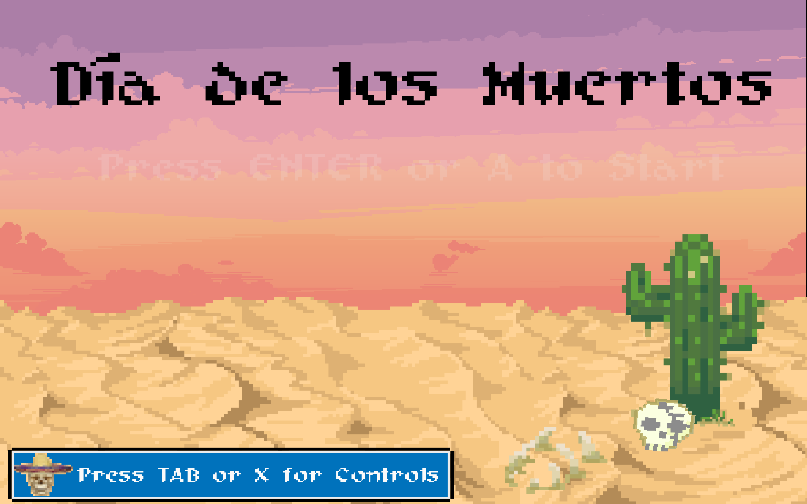
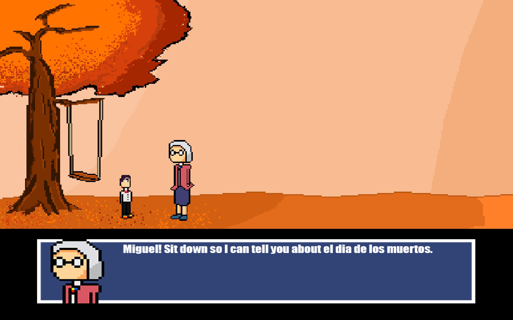
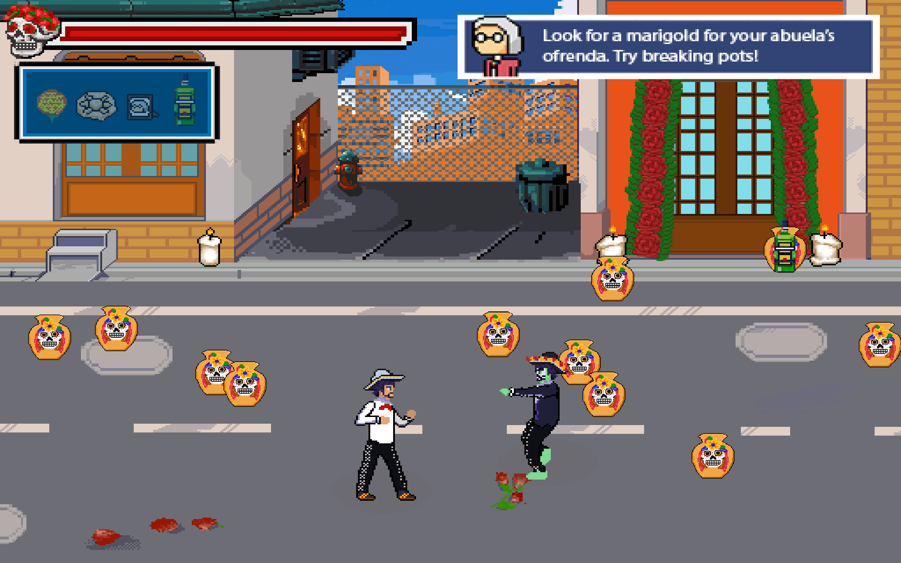
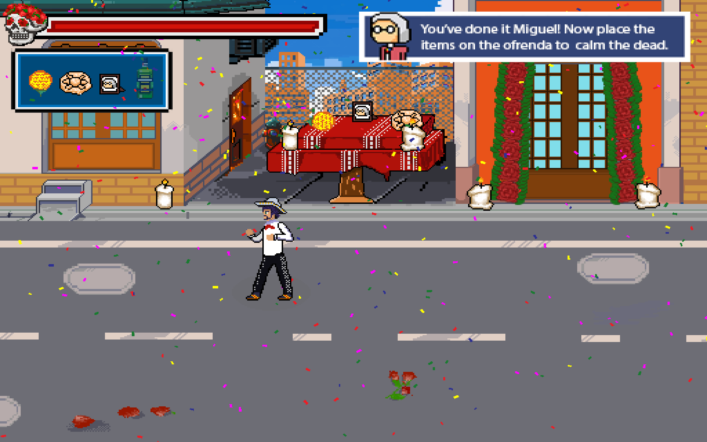
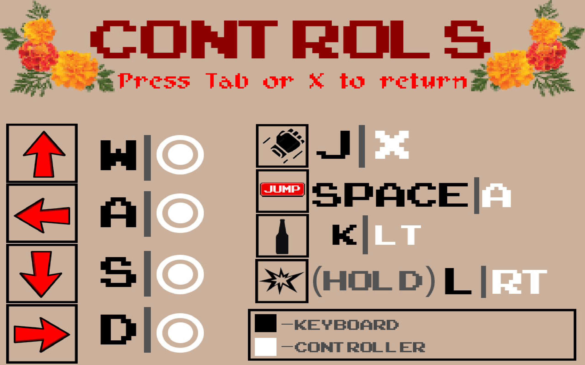
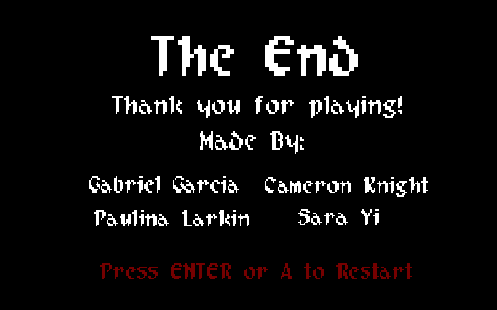

# Día de los Muertos

**A side-scrolling beat-'em-up about honoring your ancestors, built in GameMaker.**

*Día de los Muertos* is a short brawler built around the Mexican holiday of the Day of the Dead. You play as Miguel, the trusted grandson of his abuelita. The restless dead are rising, and the only way to calm them is to build a proper **ofrenda**, an altar honoring the family's ancestors. Fight through the streets by punching, swinging a guitar, and throwing tequila bottles. Break pots to find the offerings hidden inside, and bring them home to the altar.

   
  <i>Title screen</i>

> **About this repo:** this is the full GameMaker project: code, sprites, rooms, and audio.

---

## Features

- **Three levels of street brawling** that get harder as you go, with faster zombie spawns and a new enemy type, La Catrina
- **Three attacks:** a quick punch, a thrown tequila bottle, and a charged guitar strum that knocks enemies back
- **Two enemy types with their own AI:** shambling mariachi zombies and La Catrina, who keeps her distance and lobs bottles
- **Breakable pots** placed at random, with a marigold, pan de muerto, or family photo hidden in one of them
- **A story told in illustrated cutscenes,** with Abuelita guiding you through the game
- **An ofrenda tracker that fills in** as you collect each offering, with a celebration once it's complete
- **Keyboard and full gamepad support,** plus original music and sound effects

   
  <i>Abuelita tells Miguel about the Day of the Dead</i>

## How it works

### One movement system for everyone

The player and every enemy run through the **same movement, attack, and animation scripts**. The only difference is where their input comes from. The player's script reads the keyboard or gamepad. Each enemy's AI script fills in the same set of variables (left, right, up, down, attack) as if it were pressing buttons. Because of this, enemies follow the same rules the player does for hits, stuns, knockback, and animation, and a new enemy type only needs its own AI script.

### Belt-scroller depth

Like classic beat-'em-ups, the street is a 2D plane with depth. Each character tracks a ground position separately from its jump height, collides using its **shadow** rather than its body, and is drawn in front of or behind others based on where it stands. Players can jump over attacks and line up with enemies on the street.

### Enemy AI

**Mariachi Zombies** shamble toward the player. Random reaction delays and attack timing keep a crowd of zombies from moving in lockstep. **La Catrina** is a ranged enemy. She closes to throwing distance, backs away if the player gets too close, and throws tequila bottles from range. Avoiding her bottles while zombies close in is the core challenge of the later levels.

### Combat

Attacks are timed to their animation frames, and hits cause stun and knockback. Knockback is clamped to the screen edges so enemies can't be knocked out of the playable area. The guitar is a **charge attack**: hold to wind up, then release to strum. Releasing too early cancels the attack.

   
  <i>Brawling through the streets while Abuelita gives hints from the top of the screen</i>

### The ofrenda

Each level hides one offering in a randomly chosen pot. Once all three are collected, the player reaches the ofrenda, places the offerings, and the altar updates to show each one. A confetti celebration plays to finish the game.

   
  <i>Completing the ofrenda</i>

## Controls

  

| Action | Keyboard | Controller |
|---|---|---|
| Move | W A S D | Left stick |
| Punch | J | X |
| Jump | Space | A |
| Throw tequila bottle | K | LT |
| Guitar charge attack | Hold L, release to strum | Hold RT, release to strum |
| View controls | Tab | X (on the title screen) |

## Tech

| | |
|---|---|
| **Engine** | GameMaker (IDE 2022.11) |
| **Language** | GML |
| **Platform** | PC (Windows) |
| **Development** | Fall 2022 |

## Running the project

1. Install [GameMaker](https://gamemaker.io/).
2. Clone this repo.
3. Open `prototype1.yyp` and press **Run**.

## Team

*Día de los Muertos* was made by a 4-person team:

- **Gabriel Garcia** Designer + Artist
- **Cameron Knight** Engineer
- **Paulina Larkin** Artist
- **Sara Yi** Artist

  

### Secret mode

Finishing the ofrenda isn't quite the end. A hidden key combo on the final level unlocks an **endless survival mode**: a party-filled arena three times wider than a normal level, with confetti falling the whole time and tequila bottles scattered everywhere. The catch is that every enemy spawn makes the next one come a little sooner, until zombies and La Catrinas are pouring in nonstop. There's no winning, only seeing how long you last.

<b>Spoiler: how to unlock it</b>

 

Reach the ofrenda on the final level. Before the ending cutscene plays, hold **Left Ctrl + Left Shift + Z** together. The window includes the confetti celebration right after you place the offerings. Keyboard only, and it has to be the left-hand Ctrl and Shift.

